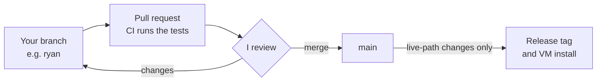

# CreditTrading

QUANTT's credit trading book, run by the Credit Trading Team at Queen's University.

[](https://github.com/quanttqueensu/CreditTrading/actions/workflows/checks.yml)

I'm Simon, and I run the book. This page is for the three analysts working with me
this year: what we trade, what each of you will work on, and how your work gets into
the repo. Setting up your Mac is in [`docs/ONBOARDING.md`](docs/ONBOARDING.md), and the
detailed rules of the team are in [`docs/TEAM.md`](docs/TEAM.md).

## What we trade

We run a systematic long/short book in credit closed-end funds (CEFs). A CEF
publishes its net asset value every day, but its shares trade at whatever the market
will pay, usually at a discount. Nothing creates or redeems the shares, so nothing
forces that discount to close.

Every evening the book compares each fund's discount with its own history. It buys
the funds that are unusually cheap, shorts the ones that are unusually rich, in equal
dollars, and sizes the whole book to a volatility target. A position is only traded
once it drifts outside a no-trade band. Orders go in at the next day's close, and the
position earns the day after that. We call that lag `shift(2)`, and every backtest in
this repo has to use it.

The book trades by itself every day on an Alpaca paper account, from a cloud VM that
only I can reach. Real capital is planned, which is why so much of our work is about
costs.

The full description is in [`docs/SYSTEM.md`](docs/SYSTEM.md). Anything that changes day
to day (whether prod is running, the account, the spec, how many trials each counter
has used) comes from `python3 -m ops.orient`. I keep those numbers off this page
because they go stale.

## What you'll work on this year

Each of you starts in a lane. You keep its folders working and bring me results. The
lanes are starting points, not limits: any of you can propose a signal, or any other
addition that helps the book, and I approve every test before it runs. You can propose
a change anywhere in the repo through a pull request.

Each of you pitches one idea to the execs at the end of November, as a short talk with
slides. It can be an addition to the strategy, a signal, or anything else that helps us
overall. I'll confirm the date.

All of it feeds one book. The CEF discount book is the core, the corporate-event
sleeves sit beside it, and anything you find joins them in one of three ways: as a
sleeve of its own, as an overlay or conditioner on the CEF book, or as a hedge. A
signal earns its place by what it adds to the whole book after costs
([`results/cef/PORTFOLIO_FRAMEWORK_2026-10-15.md`](results/cef/PORTFOLIO_FRAMEWORK_2026-10-15.md)).

The corporate-event work stays with me, so bring new signals rather than picking up
mine. The live status of every project is in
[`docs/RESEARCH_STATE.md`](docs/RESEARCH_STATE.md). Each of you also gets a detailed
plan to the end of December from me directly. It isn't in the repo because it has
your names in it.

### FICC risk

Counter MACRO, and every test you run adds to it. Folders `scripts/macro/` and
`results/macro/`. Branch `ryan`.

Start with the risk in the book we hold: its rate, credit and muni exposure
(`scripts/cef/exposure_readout.py`) and what moved the live P&L
(`scripts/cef/live_attribution.py`). From there, go wherever it helps most.

Anything in fixed income that can help the book: macro events (central-bank
decisions, economic releases, Treasury auctions), credit events, and the
instruments themselves (rate and credit ETFs, preferreds, baby bonds). For each idea,
the question is how it helps our funds: as a conditioner on the CEF book, as a hedge,
or as a sleeve of its own.

- Start with the graveyard (`/graveyard`). A lot has already died in this space:
  credit-ETF relative value, raw ETF flow, crowded-hedge short pressure, credit and
  rates trend, and the month-end Treasury extension, which was real but turned out to
  be term premium. The forced IG-to-HY index deletion on WATCH stays with me.
- Build a dated calendar of the events you want to test, from primary sources. Every
  calendar gets a fetcher and a source note.
- Pre-register each test, and get my approval, before you run it.

The goal is one fixed-income signal that improves the book after costs, or a clean
record of what doesn't.

### Equity risk

Counter XASSET. Folders `scripts/xasset/` and `results/xasset/`. Branch `james`.

Start with the equity risk in the book we hold, first C4: its market, sector and factor
exposures (`scripts/xasset/book_profile.py` and `scripts/xasset/specialist_betas.py`).
From there, go wherever it helps most.

Signals in single stocks and ETFs that add to the book without adding market
exposure. We trade alpha only, so a signal that turns out to be beta in disguise
doesn't count. The equity events on my special-situations slate (insider clusters,
earnings-date delays, 8-K red flags, index changes) and their ETF hedge stay with me.

- Read why the first slate of four ETF signals failed in October before designing a
  new one: two had no edge and two were risk premia
  ([`results/xasset/XASSET_RESULTS_2026-10-14.md`](results/xasset/XASSET_RESULTS_2026-10-14.md)).
- Declare each new slate up front in one pre-registration, single names included.
- Work out how a passing sleeve would sit beside the book
  ([`results/cef/PORTFOLIO_FRAMEWORK_2026-10-15.md`](results/cef/PORTFOLIO_FRAMEWORK_2026-10-15.md)).

The goal is one equity or ETF sleeve passing on paper, or a slate that settles the
question either way.

### Cross-asset signals, dashboard and data

Look for signals from other markets, starting from why the first four failed
([`results/xasset/XASSET_RESULTS_2026-10-14.md`](results/xasset/XASSET_RESULTS_2026-10-14.md)),
and build the dashboard. Counter XASSET for signals.

Folders `dashboard/` and the research data platform (`scripts/data/` and its
neighbours, listed in [`docs/TEAM.md`](docs/TEAM.md#1-the-lanes)). Branch `lucy`.

The public site (eventdriven.quantt.ca) and its read-only dashboard: every book's live
paper results, built on the VM every 30 minutes from the runners' own records. Nothing
on it may be able to send an order, and nothing about positions or P&L is committed
([`dashboard/README.md`](dashboard/README.md)).

- Define the snapshot: what it carries and what it never carries. Then write the spec
  and tests for the exporter that writes it. I install it on the VM.
- Build the dashboard against a fixture snapshot first. Build on what already reads
  the system without touching it: `ops/orient.py` and `ops/prod_state.py`.
- Keep the research data the other two lanes build on: fetchers, data builds and
  source notes, and the event store once my event work is merged into `main`.

The goal is a dashboard we check every day instead of running orient by hand, and
data the other two can trust.

### Me

The core CEF book and its costs, everything that can change what the book trades,
prod, releases, and the decision on every trial. I'm also keeping the corporate-event
work (NAV tenders, the special-situations slate and its hedge overlay, E2 to E4, and
E1's holdout; E1's fit was killed on 22 October), the one options test, and CI. The
big item this year is the real-money cost check
(`scripts/cef/real_money_costs.py`): the book has to stay positive after measured
borrow, distributions owed on shorts and real auction fills before any real capital
goes in. My work in progress sits on `simon`.

## Getting started

1. Accept the GitHub invitation to this repo. It arrives by email.
2. Set up your Mac with [`docs/ONBOARDING.md`](docs/ONBOARDING.md#2-set-up-your-mac):
   clone, install, and put your own keys in `config/.env`.
3. Run the three checks:
   ```bash
   python3 -m ops.orient            # PROD shows UNMEASURED on your machine, which is expected
   python3 -m pytest                # nothing should fail
   python3 -m ops.doc_audit --check # no DRIFT
   ```
4. Add one line to your own `~/.claude/CLAUDE.md` saying which lane you're in, so
   Claude knows you're an analyst (step 2.6 of the onboarding).
5. Read the ten files in
   [the reading order](docs/ONBOARDING.md#4-what-to-read-in-order), then your lane's.

## Making a change

You work on your lane's branch and send me pull requests. I review them and merge
into `main`. If a change touches the live book, I also tag a release and install it on
the VM.



```bash
git fetch origin
git switch ryan                  # your branch: ryan, james or lucy
git merge origin/main            # do this at the start of every day
# ...work and commit...
python3 -m pytest && python3 -m ops.doc_audit --check
git push
gh pr create --base main         # when a piece is ready for me
```

GitHub holds five branches and no more: `main`, one for each of you (`ryan`, `james`,
`lucy`) and mine, `simon`. Please don't create others. A
branch can only have one open pull request, so anything you push while yours is open
joins it. Keep pieces small and I'll merge them quickly.

Trials work differently from everything else. Anything that computes a strategy's
returns spends a trial, so write the pre-registration first (`/prereg`), send it to me
as a PR, and only run it once I've approved it. Counts, gates, reproductions and data
work don't need that step. The details are in
[`docs/TEAM.md`](docs/TEAM.md#4-trials-and-the-shared-ledgers).

## Ground rules

- Don't place, change or cancel orders, and don't run `quantt.session` or
  `quantt.collect`. You don't hold keys for the book's account, and an order can't be
  undone.
- Don't commit credentials, or row-level licensed data (CRSP, TRACE, anything from
  WRDS). The repo is public.
- Don't make up numbers. Every figure says which script produced it and when.
- Backtest with `evaluate()` in [`scripts/cef/band_frontier.py`](scripts/cef/band_frontier.py).
  Lead with gross P&L and put the 5/15/30bp cost grid beside it.
- Run `/graveyard` before proposing an idea. Most of them have been tried.
- I'm the only one who merges to `main` or deploys, and GitHub enforces that
  ([`docs/TEAM.md`](docs/TEAM.md#6-access)).

The full rules are in [`CLAUDE.md`](CLAUDE.md). They apply to people as well as to
Claude.

## Finding things

| Looking for | Go to |
|---|---|
| What is true right now | `python3 -m ops.orient` |
| How the strategy and the system work | [`docs/SYSTEM.md`](docs/SYSTEM.md) |
| The code that trades | [`src/deploy/sleeves/cef_discount.py`](src/deploy/sleeves/cef_discount.py) |
| How a trading day runs | [`docs/RUNNER.md`](docs/RUNNER.md) |
| What's been tried, and what died | [`docs/RESEARCH_STATE.md`](docs/RESEARCH_STATE.md) |
| The research plan | [`results/cef/RESEARCH_PLAN_2026-10-09.md`](results/cef/RESEARCH_PLAN_2026-10-09.md) |
| Data sources | [`docs/DATA.md`](docs/DATA.md) |
| Your lane and what you may touch | [`docs/TEAM.md`](docs/TEAM.md) |
| Which document answers what | [`docs/INDEX.md`](docs/INDEX.md) |

<details>
<summary>Repository map</summary>

```
src/deploy/          the strategy: sleeves/cef_discount.py is the book          live
quantt/              the runner (decide, check, send, verify), collector, installers   live
ops/specs/, books/   the frozen spec and the book's settings                    live
ops/                 orient, doc_audit, prod_state, NYSE calendar, network guard
scripts/cef/         the research harness: band_frontier, validate, CEF trials
scripts/macro/       fixed-income research (macro events, credit events, FI instruments)
scripts/xasset/      equity and ETF research
scripts/events/      corporate-event research
scripts/gamma/       options research
scripts/data/        fetchers and data builds: EDGAR, CRSP, CEFConnect, factors
dashboard/           the read-only dashboard; snapshots/ holds the book's nightly snapshot
src/backtest/        the original engine, lookahead guard, cost model
results/<family>/    dated findings and pre-registrations
docs/                the documents, one owner per question (docs/INDEX.md)
.claude/             Claude Code: skills, agents, hooks, workflows
config/              the cost model, and your own .env (never committed)
data/                the data panels: not in git, you build your own
```

Anything marked live can change the book, so it needs a test, my review and a release.

</details>

<details>
<summary>Commands you'll use</summary>

```bash
python3 -m ops.orient                                # what is true right now
python3 -m pytest                                    # the tests
python3 -m ops.doc_audit --check                     # do the documents still say true things?
python3 -m quantt.broker.alpaca_probe --check-keys   # which of your keys are set (prints no values)
python3 scripts/cef/stage_cef.py                     # build the CEF price and NAV panels
python3 scripts/cef/fetch_daily.py                   # bring them up to date
python3 scripts/cef/band_frontier.py                 # the trading-policy frontier
```

In Claude Code, the skills you'll use most are `/graveyard`, `/harness`, `/repro` and
`/prereg`, plus the `/research-idea` and `/backtest-request` workflows. Ask for the
`beta-detector` or `quant-reviewer` agent before you trust a result.

</details>

<details>
<summary>History</summary>

The repo was cut back to a clean slate on 2026-09-28, when the book moved from IBKR to
Alpaca. Everything from before then is in git at the tag `pre-clean-slate`, summarised
in [`docs/HISTORY.md`](docs/HISTORY.md).

</details>
