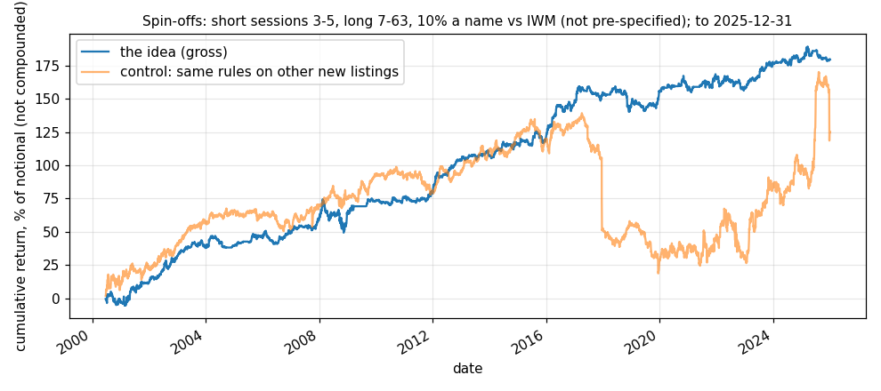
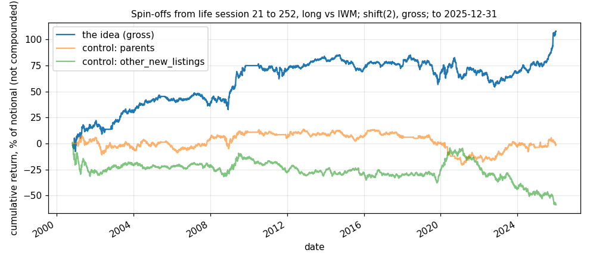

# Idea card — spin-offs: the new company falls in its first week, then recovers

**Slugs:** `spinoff_first_week`, `spinoff_rebound`, `spinoff_seasoned` · **Written:** 2026-11-12 ·
**Status:** `spinoff_first_week` SHADOW from 2026-11-16; `spinoff_rebound` and
`spinoff_seasoned` EXPLORE, weak ·
**Reproducer:** `python3 results/ideas/spinoffs/explore.py` ·
**Panels:** CRSP distributions and daily rows on R2 (`scripts/research/stage_crsp_spinoffs.py`), spin-offs with
ex-dates 2000-01-03 to 2025-11-03, prices to **2025-12-31**; IWM and SPY total returns from Yahoo (2026-11-09).
CRSP rows are not in the repository.

## The idea

Holders of a parent company are handed shares in a company they did not choose. Index funds
and large-company mandates must sell them, and others sell what they do not know. The new
company should be weak at first and strong once the selling is done. The desk's catalogue
(`results/events/SPECIAL_SITUATIONS_CATALOGUE_CORP_2026-10-15.md`, B1) counted spin-offs in
October and computed no return.

## What was fixed before the test

- **The event:** CRSP's spin-off code, where the distributed company is a US common share
  whose first daily row is within 10 days of the ex-date. 395 such companies; 26 others
  already traded and are left out. Life session 1 is the first row; CRSP gives it no return.
- **The profile:** the company's return less IWM's over fixed blocks of its life.
- **The pre-specified book, `spinoff_seasoned`:** long each spin-off from the close of life
  session 21 to session 252 ($5, $1M a day), half the book, against IWM; flat under 5 names.
- **Controls:** every other newly listed US common share in the period (5,725, mostly
  IPOs), and the parents from the ex-date.
- `shift(2)`, gross, no cost and no borrow modelled.

## Where the return sits [V: reproducer run 2026-11-12]

Mean return less IWM, in % (t from spin-offs grouped by start month), by life sessions:

| group | names | 2–5 | 6–20 | 21–63 | 64–126 | 127–252 | 253–504 |
|---|---|---|---|---|---|---|---|
| new spin-offs | 387 | -3.2 (-4.6) | +1.8 (+1.9) | +1.5 (+1.7) | +0.0 (-0.2) | +2.8 (+0.5) | +5.2 (+1.9) |
| other new listings (control) | 5,725 | -0.3 (-1.4) | +0.3 (+0.2) | -1.3 (-0.8) | -3.1 (-2.6) | -1.6 (+0.0) | -3.5 (-0.9) |
| parents, from the ex-date | 330 | +0.1 (+0.3) | -1.8 (-2.7) | +0.1 (+0.4) | +0.2 (-0.1) | +0.1 (-0.6) | +4.3 (+1.5) |

Session by session, sessions 2 to 12:

| | 2 | 3 | 4 | 5 | 6 | 7 | 8 | 9 | 10 | 11 | 12 |
|---|---|---|---|---|---|---|---|---|---|---|---|
| spin-offs | -0.47 (-1.5) | -0.73 (-1.4) | -1.19 (-4.4) | -0.85 (-2.1) | -0.55 (-1.7) | -0.07 (-0.1) | -0.02 (+0.1) | +0.44 (+2.2) | +0.35 (+1.2) | +0.34 (+1.6) | +0.10 (-1.0) |
| other new listings | +0.37 (+0.5) | -0.21 (-1.0) | -0.19 (-1.1) | -0.25 (-1.9) | -0.22 (-2.4) | -0.13 (-1.7) | -0.10 (-1.0) | +0.02 (-0.2) | +0.07 (+1.2) | +0.03 (+0.7) | +0.01 (-0.5) |

- **The new company falls in each of sessions 2 to 6**, about 3.8% in all against small
  companies, is flat for two sessions, and rises from session 9.
- **Other new listings do not do this.** Their first week is slightly weak (−0.65% over
  sessions 3–5, and −0.21%, t −0.5, on the names liquid enough to trade).
- **Parents** lose 1.8% over sessions 6–20 after the ex-date and nothing else stands out.
- **The fall is in liquid spin-offs too** [V: session check, not stored]: −2.2% over sessions
  3–5 (t −3.8) for the 207 with $50M or more traded on day one. It is −3.7% for 2000–12 and
  −2.1% for 2013–25.

## The pre-specified book: weak

| sample | from | to | sessions | active | return / yr | vol / yr | Sharpe | t | bp per active day | hit rate |
|---|---|---|---|---|---|---|---|---|---|---|
| full | 2000-11-02 | 2025-12-31 | 6,327 | 6,038 | 4.30% | 8.75% | 0.49 | 2.46 | 1.8 | 51.0% |
| early half | 2000-11-02 | 2013-06-05 | 3,164 | 2,875 | 6.30% | 9.39% | 0.67 | 2.38 | 2.8 | 51.6% |
| late half | 2013-06-05 | 2025-12-31 | 3,164 | 3,164 | 2.29% | 8.05% | 0.28 | 1.01 | 0.9 | 50.4% |
| 2002-2008 | 2002-01-02 | 2008-12-31 | 1,763 | 1,638 | 3.78% | 8.30% | 0.46 | 1.21 | 1.6 | 50.9% |
| 2009-2015 | 2009-01-02 | 2015-12-31 | 1,762 | 1,598 | 3.78% | 7.52% | 0.50 | 1.33 | 1.7 | 49.9% |
| 2016-2019 | 2016-01-04 | 2019-12-31 | 1,006 | 1,006 | -0.87% | 7.13% | -0.12 | -0.24 | -0.3 | 49.5% |
| 2020-2022 | 2020-01-02 | 2022-12-30 | 756 | 756 | -3.54% | 10.42% | -0.34 | -0.59 | -1.4 | 48.4% |
| 2023-2025 | 2023-01-03 | 2025-12-31 | 752 | 752 | 16.80% | 8.58% | 1.96 | 3.38 | 6.7 | 56.8% |
| control: parents | 2000-11-02 | 2025-12-31 | 6,327 | 5,588 | -0.04% | 6.50% | -0.01 | -0.03 | -0.0 | 49.4% |
| control: other_new_listings | 2000-11-02 | 2025-12-31 | 6,327 | 6,327 | -2.34% | 7.02% | -0.33 | -1.67 | -0.9 | 49.7% |

337 spin-offs held, 11 live at the median, turnover 2.2 times a year.
Sharpe 0.49 with halves of 0.67 and 0.28, negative in 2016–22 and 1.96 in 2023–25. The
reviewer found the ten best names are 78% of its P&L. **Fragile; not promoted.**

## Two event books read from the session profile (NOT pre-specified)

The windows below were chosen after seeing the table above. Each live name takes a fixed
10% of the book with IWM the same size the other way.

| book | Sharpe (t) | return / yr | vol | halves | eras | note |
|---|---|---|---|---|---|---|
| `spinoff_first_week`: short sessions 3–5 | 0.96 (4.84) | 3.18% | 3.31% | 1.07 / 0.88 | 1.31, 0.35, 1.25, 1.58, 0.50 | 336 names; invested 12% of sessions |
| `spinoff_rebound`: long sessions 7–63 | 0.47 (2.36) | 3.87% | 8.28% | 0.61 / 0.32 | 0.40, 1.09, 0.46, -0.56, 0.70 | 344 names; invested 91% of sessions |
| both | 0.80 (4.03) | 7.05% | 8.83% | 0.93 / 0.66 | 0.80, 1.16, 0.91, 0.09, 0.83 |  |
| control: first-week rule on other new listings | 0.22 (1.13) | 3.75% | 16.69% | 0.51 / 0.14 | 0.51, 0.02, -1.28, 0.81, 1.21 | not like for like: it sits at the 50% cap |

- **The first-week short is decided at the close of day one** and filled at the next close,
  so it earns sessions 3, 4 and 5. Session 2's fall cannot be earned under `shift(2)`.
- **On the 336 names it trades the fall is 2.45%** (median 1.98%, t −4.5; 2.31% winsorised),
  against 2.77% on all 387. 65% of the names make money.
- **It is positive in every era** (eras column) and in both halves.
- **It is small and occasional**: about 13 spin-offs a year pass the screen, three sessions
  each. 3.2% a year is on a book that is in the market on 12% of sessions at 10% a name.

## Independent review [V: quant-reviewer agent, 2026-11-12]

A separate reviewer found no lookahead, indexing, alignment or sign defect and reproduced
every figure. Its checks: the book holds exactly sessions 3, 4 and 5 (336 name-days each);
weights rebuilt on data cut at 40 random dates were identical; the first row equals the
ex-date for 368 of 395 companies and the result is the same using only those (0.97);
moving the window to sessions 4–6 gives 0.96 and to 6–8 gives 0.14; beta to IWM 0.006,
alpha 3.0% a year (t 4.3); no missing returns on held days. **Its cautions:**
- **Concentration.** The ten best names are 41% of the first-week book's P&L. Without them
  the Sharpe is 0.64 (t 3.2); without twenty, 0.41. That removes winners only, so it is a
  lower bound.
- **The seasoned book earns sessions 23 to 254**, two later than its description said; the
  description is corrected.

## What the gross figure does not show

- **Borrow.** The trade shorts a share on its second day of trading. Whether a locate can be
  had that early is [U], and it decides whether this is tradable at all. Paper charges no
  borrow and may show a new symbol as shortable when a real desk could not find it.
- **When-issued trading.** Many spin-offs trade when-issued before day one. CRSP has no such
  rows, so the pressure may start earlier than this test can see.
- **Costs.** A 2.45% move over three sessions is large against a spread, but a new share's
  spread in its first days is unmeasured here.
- **The windows were chosen after looking**, on 387 events.

## On shadow from 2026-11-16 [V: local run 2026-11-14]

`shadow/books/spinoff_first_week.json`, $1M: short each new spin-off for 10% of the book on
the decisions of its first three regular-way sessions (earning sessions 3 to 5), long IWM
the same size, at most 50% a side (`shadow/signals/spinoff.py`).
- **The live source is Alpaca's corporate-actions feed, and when a row appears is unknown.**
  The feed showed no future-dated spin-off on 2026-11-14, and history cannot say when each
  past row was published. Every row is stored with the day it was first seen and the book
  reads only rows seen by the decision date, so a late row is a shorter trade or a missed
  one. The scoreboard will show which; that is the first thing this book measures.
- **The feed is noisy.** Of the 6 rows from the last 30 days, 3 are contingent value rights,
  1 is an already listed share, 1 is back-filled and 1 is a real new company. The signal
  keeps a row only if Alpaca lists the new symbol as a share on an exchange this desk can
  read a closing print for, and it has no price history before its ex-date.
- **When-issued prices are ignored.** Yahoo shows them for a few days before the ex-date;
  life is counted from the ex-date, which is what CRSP's first row was in the research.
- **Borrow is recorded, not assumed.** Each night the fetcher stores what Alpaca says about
  shorting each share in its first days. That is the broker's flag, not a locate.
- **One real case so far, replayed and not a record:** MSGR, first regular-way session
  2026-10-27. The rule fires on 10-27, 10-28 and 10-29. The share rose 16.3% on its third
  session (Yahoo closes), and over sessions 3 to 5 the trade would have lost about 1.7% of
  the book after the IWM leg. One event says nothing
  about the average, but it is what the tail looks like.
- **Events are rare**: about 13 a year passed the screen in the research.

## Verdict

- **`spinoff_first_week`: SHADOW from 2026-11-16**, with the cautions above.
- **`spinoff_rebound`: EXPLORE, weak** (0.47, negative in 2020–22).
- **`spinoff_seasoned`: EXPLORE, weak and fragile.**

